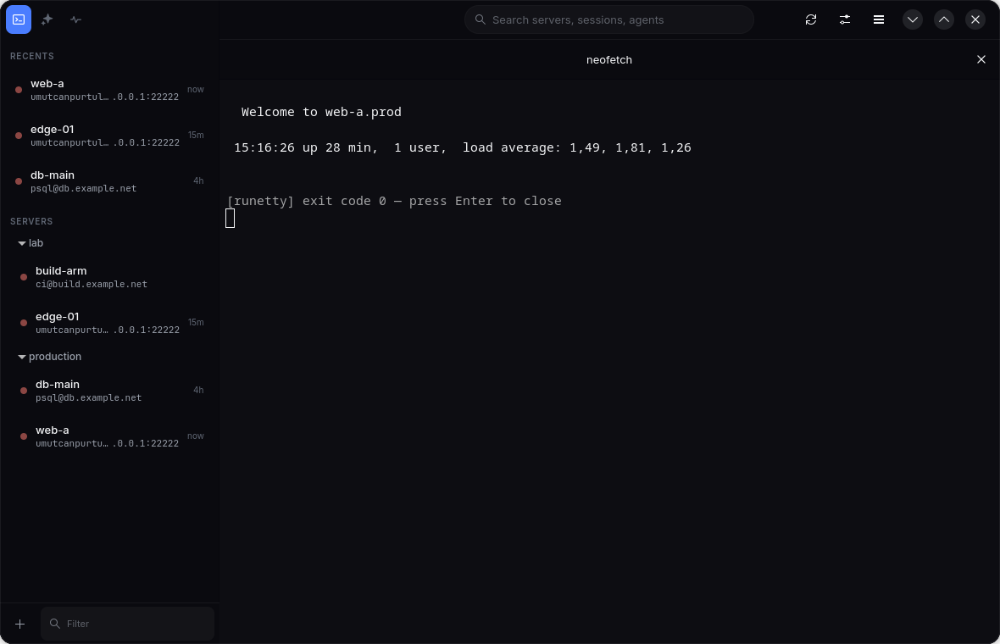
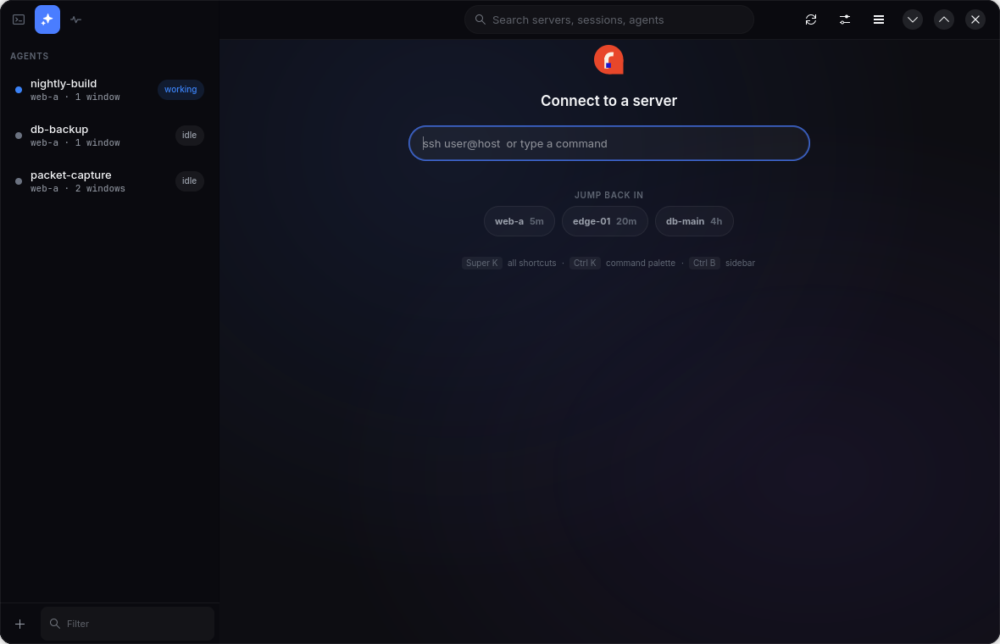
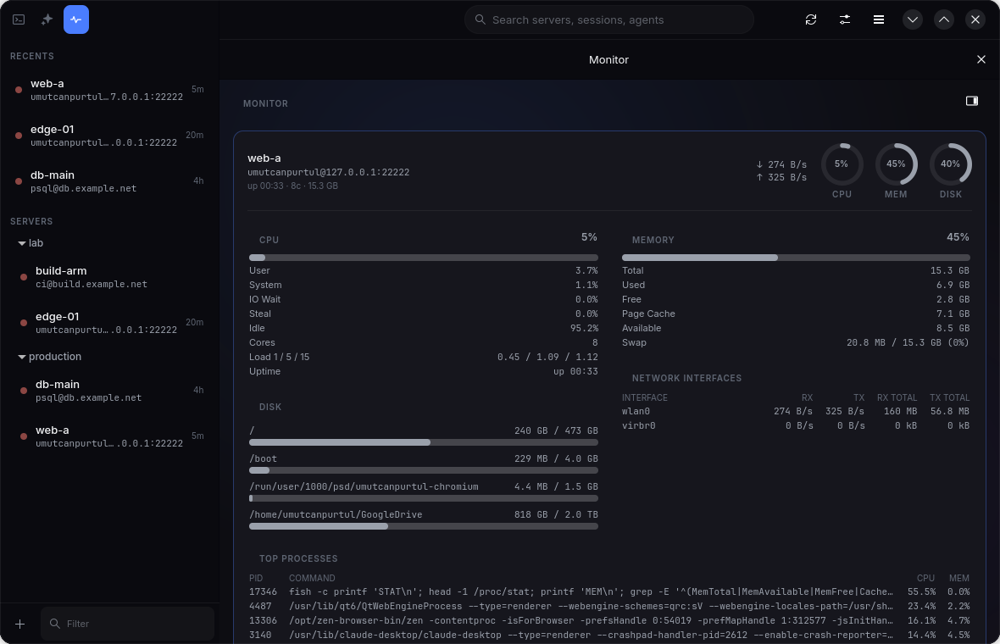

<div align="center">


# runetty

**Your SSH sessions, long-running jobs and server health — in one native Linux window.**

A GTK4 + libadwaita desktop client that reads your existing `~/.ssh/config`,
keeps passwords in the system keyring, and needs nothing installed on your servers.

[](https://github.com/umutcanpurtul-avi/runetty/actions/workflows/build.yml)
[](LICENSE)


[Features](#features) ·
[Install](#install) ·
[Getting started](#getting-started) ·
[Security model](#security-model) ·
[Shortcuts](#keyboard-shortcuts) ·
[Roadmap](ROADMAP.md)

<!-- Generate with: ./target/release/runetty --mode sessions --demo-metrics --screenshot docs/screenshots/hero.png -->


</div>

---

## Why runetty?

Most people who manage a handful of Linux servers end up juggling three things:
a terminal with a dozen tabs, a `tmux ls` on every box to see what is still
running, and `htop` in yet another tab to check whether a machine is on fire.

runetty puts those three views side by side, on top of the SSH setup you
already have:

- **No new config format to learn.** Hosts come straight from `~/.ssh/config`.
  runetty never writes to that file.
- **Nothing to install on the far side.** Monitoring reads `/proc`, agents are
  plain `tmux` sessions. If a server has `ssh`, it works.
- **One handshake per host.** Terminal tabs, Monitor and Agents share a single
  `ControlMaster` channel, so a host is authenticated once — not once per probe.
- **Native, not Electron.** Rust, GTK4 and libadwaita; it follows your system
  theme and fonts.

## Features

runetty has three modes, switched from the icon rail at the top of the sidebar.

### Sessions



- Tabbed VTE terminals with real shell keybindings (Ctrl+C stays an interrupt)
- Sidebar with **Recents** and **Servers**, a folder tree, drag-and-drop and filtering
- Hosts from `~/.ssh/config` plus runetty's own records, side by side
- Live status dot for every host with an open session
- Empty-state command field: type `ssh user@host` or any command and press Enter
- "Jump back in" chips for the hosts you used last
- Ctrl-click or middle-click a server to open an extra session to it

### Agents



An "agent" is any detached piece of work: a build, a packet capture, a
backup, an AI coding agent. They almost always live in `tmux` already, so
runetty simply runs `tmux list-sessions` on each watched host and lists what
it finds. Hosts without tmux contribute nothing — no errors, no setup.

Each row shows whether the session wants attention, is working or is idle,
taken from tmux's own alerts and activity. Click one to open a tab attached
to it.

### Monitor



- **Opt-in per host** — nothing is probed unless you add it to the watch list
- CPU / MEM / DISK rings on a card per host, refreshed every two seconds
- Click a card for the detail view: CPU breakdown (user / system / iowait / steal),
  memory and swap, load average, every mounted disk, network interface rates,
  top processes, uptime
- Can be pinned as a side pane next to your terminals
- Rounds stop entirely while the Monitor is hidden — no background network or CPU cost

### And also

- Light / dark / follow-system theme, configurable fonts and sizes
- Keyboard shortcut reference built in (Super+K, F1 or Ctrl+?)
- Builds natively on Arch, Fedora, Debian 13, Ubuntu 24.04+, openSUSE — and on
  everything else through Flatpak

## Install

> **Early release.** runetty is used daily by its author, but it is young and
> has not had an independent security review. Read the
> [security model](#security-model) before trusting it with credentials.

### Option A — Flatpak (any distribution)

The recommended route, and the only one for Debian 12, Ubuntu 22.04 and RHEL 9.
It pins GTK, libadwaita and VTE to the same versions everywhere.

```bash
git clone https://github.com/umutcanpurtul-avi/runetty && cd runetty
flatpak install -y flathub org.gnome.Platform//50 org.gnome.Sdk//50 \
    org.freedesktop.Sdk.Extension.rust-stable//25.08
flatpak-builder --user --install --force-clean build build-aux/dev.runetty.Runetty.yaml
flatpak run dev.runetty.Runetty
```

### Option B — Native build

Requires GTK 4.14, libadwaita 1.5, VTE 0.76 (the Ubuntu 24.04 floor) and Rust 1.92+.

```bash
git clone https://github.com/umutcanpurtul-avi/runetty && cd runetty
./build-aux/install-deps.sh     # detects pacman / apt / dnf / zypper
cargo build --release
./build-aux/install.sh          # installs into ~/.local
runetty
```

The dependency script checks your library versions at the end and tells you to
use Flatpak if they are too old.

| Distribution | Native | Flatpak |
| --- | :---: | :---: |
| Arch / CachyOS / EndeavourOS | ✅ | ✅ |
| Fedora 40+ | ✅ | ✅ |
| Ubuntu 24.04+ | ✅ | ✅ |
| Debian 13 (trixie) | ✅ | ✅ |
| openSUSE Tumbleweed | ✅ | ✅ |
| Rocky / RHEL 10 | ⚠️ no terminal | ✅ |
| Debian 12, Ubuntu 22.04, RHEL 9 | ❌ | ✅ |

Full matrix, package lists and troubleshooting: **[BUILDING.md](BUILDING.md)**.

## Getting started

1. **Launch runetty.** Every `Host` in your `~/.ssh/config` already shows up
   under *Servers*. Wildcard patterns like `Host *.internal` are skipped; your file is never modified.
2. **Connect.** Click a server. On the first connection runetty shows the host
   key fingerprint and writes it to `known_hosts` only if you approve.
3. **Add a server** that is not in your ssh config with **Ctrl+N**. Leave the
   password empty to use your keys, or fill it in to store it in the keyring.
4. **Organise.** Drag servers onto folders; right-click to connect, open a new session,
   edit or hide.
5. **Watch a host.** Right-click → *Add to Monitor*; it then shows up in Monitor and Agents.
6. **Check on long jobs.** Start them in `tmux` on the server as usual; they
   appear in *Agents*.

## Security model

runetty handles your server access, so here is exactly what it does with it.

| Concern | What runetty does |
| --- | --- |
| **Passwords** | Stored in the system keyring (Secret Service — GNOME Keyring or KWallet). Never written to any file. |
| **Passing secrets to ssh** | Through `SSH_ASKPASS`, so a password never appears on a command line or in `ps`. No `sshpass`. |
| **Key passphrases** | Recognised by prompt text and asked for in a small dialog; never answered with a host password. |
| **Host keys** | Fetched with `ssh-keyscan`, fingerprint shown, saved to `known_hosts` **only after you approve**. Never auto-accepted. |
| **`~/.ssh/config`** | Read-only. Deleting a record from it only hides it in runetty (and can be undone), because `ssh`, `scp` and `rsync` use that file too. |
| **Remote footprint** | None. Monitor reads `/proc` and `df`; Agents runs `tmux list-sessions`. No daemon, no agent, no install. |
| **Network** | Only the SSH connections you open or the hosts you explicitly watch. No telemetry. |
| **Record files** | Written `0600`; `~/.ssh` is created `0700` if it does not exist. |
| **Shell safety** | Record fields reach a shell through the terminal, so they are quoted and the quoting is tested against a real shell. |

If the keyring is not available, the password simply is not saved — runetty
says so and ssh asks in the terminal as usual.

### Where things are stored

| What | Where |
| --- | --- |
| Connection settings | `~/.ssh/config` (read-only) |
| runetty's records: folders, watch list, timestamps | `~/.config/runetty/hosts.toml` |
| Appearance | `~/.config/runetty/settings.toml` |
| Passwords | System keyring |

## Keyboard shortcuts

Press **Super+K** (or F1 / Ctrl+?) inside the app for the full list.

| Action | Keys |
| --- | --- |
| Command palette | Ctrl+K |
| Search servers | Ctrl+Shift+K |
| New server | Ctrl+N |
| Toggle sidebar | Ctrl+B |
| Reconnect / close tab | Ctrl+R / Ctrl+W |
| Next / previous tab | Ctrl+PgDn / Ctrl+PgUp |
| Jump to tab 1–9 | Alt+1 … 9 |
| Copy / paste in terminal | Ctrl+Shift+C / Ctrl+Shift+V |
| Preferences | Ctrl+, |

Plain Ctrl+C and Ctrl+V belong to the shell, as in every other terminal emulator.

## FAQ

<details>
<summary><b>Does it work on macOS or Windows?</b></summary>

No. runetty targets Linux desktops; it depends on GTK4, VTE and the Secret
Service keyring.
</details>

<details>
<summary><b>My distribution's GTK is too old.</b></summary>

Use the Flatpak build. It ships its own GTK 4.20 / libadwaita 1.8 runtime and
builds VTE from source, so your system versions do not matter.
</details>

<details>
<summary><b>Do I need tmux for Agents?</b></summary>

Only on the servers where you want jobs to show up. Hosts without tmux are
silently skipped.
</details>

<details>
<summary><b>Monitor shows nothing for a server.</b></summary>

Monitor is opt-in: right-click the server and choose *Add to Monitor*. It reads
Linux `/proc`, so BSD or other non-Linux hosts are not supported yet.
</details>

## Contributing

Bug reports, distro test results and pull requests are all welcome, as are
ideas in [Issues](https://github.com/umutcanpurtul-avi/runetty/issues).
What is planned next is in [ROADMAP.md](ROADMAP.md).

```bash
cargo build                                   # debug build
cargo test                                    # unit tests: parsers, askpass, host keys, store
./target/debug/runetty --demo-metrics         # fill the Monitor without a network
./target/debug/runetty --screenshot out.png   # render the window offscreen and exit
```

`style.css` owns every colour — there are none in Rust. More development flags
(`--mode`, `--connect`, `--exec`, …) are listed in [BUILDING.md](BUILDING.md#visual-verification).

## Reporting a problem

Open an [issue](https://github.com/umutcanpurtul-avi/runetty/issues). For
anything security-related, please use
[private vulnerability reporting](https://github.com/umutcanpurtul-avi/runetty/security/advisories/new)
rather than a public issue.

## License

MIT — see [LICENSE](LICENSE). GTK4/libadwaita (LGPL-2.1) and VTE (LGPL-3.0)
are linked dynamically; Inter and JetBrains Mono are OFL.

The design language draws on SigilTTY; the name, logo and icon are our own.
